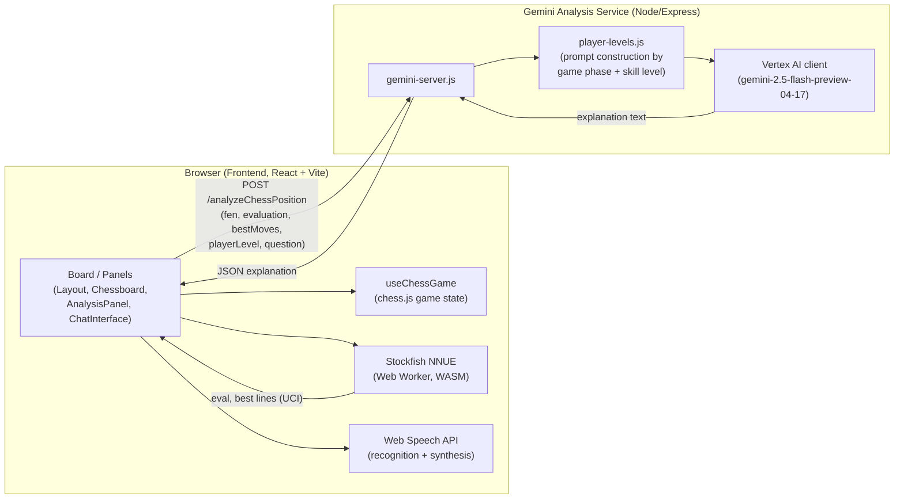
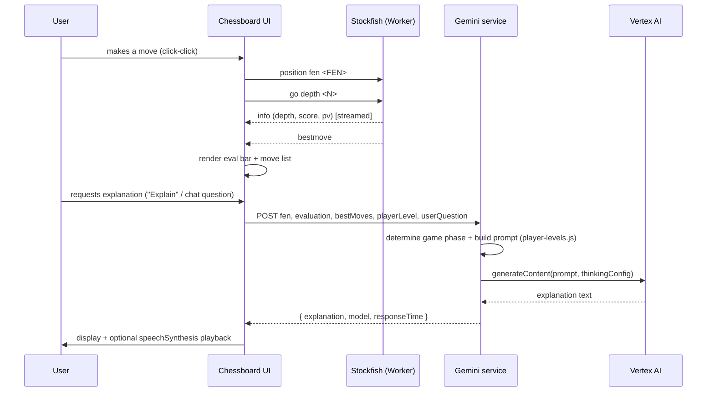

# Enpassant

An AI chess coach: play a game against yourself or step through a position, and get plain-language move explanations grounded in a real chess engine's analysis, not just an LLM guessing at chess.

**Status: Hackathon project, not actively maintained.** Built at a weekend hackathon in March 2025, then extended solo through mid-May 2025 (offline engine, cloud deployment, CI/CD). No commits since. The custom domain (`enpassant.wiki`) referenced in the deploy tooling is no longer resolving, so there is currently no live public demo (see Known limitations).

## Problem

Chess engines are extremely good at telling you the best move. They are useless at telling you *why* it's the best move in language you can learn from. Existing "AI coach" tools either skip the engine and let an LLM hallucinate chess analysis, or dump raw engine output (`+1.4`, `Nf3-e5`) on a player who doesn't know what to do with it.

Enpassant keeps the engine as the source of truth for *what* is good, and uses an LLM only to explain *why*, conditioned on the actual principal variation the engine found and on the player's stated skill level.

## Core functionality

- Interactive board (click-to-select, click-to-move) built on `react-chessboard`, with legal-move highlighting and promotion handling via `chess.js`.
- Live position evaluation from Stockfish (NNUE build) running fully client-side in a Web Worker, with no server round-trip for the engine itself.
- Multi-line analysis (MultiPV) with per-line evaluation and principal variation, a manually adjustable engine search-depth slider, and a "Deep Think" mode that raises the LLM's reasoning (thinking) budget for a more detailed explanation. Deep Think only affects the Gemini request; engine search depth is a separate, independently adjustable control.
- Natural-language move/position explanations generated by Gemini (via Vertex AI), built from a prompt that embeds the engine's actual top lines and adapts vocabulary and depth of explanation to a beginner/intermediate/advanced setting.
- A chat panel for asking follow-up questions about the position, including voice input (browser Web Speech API) and spoken responses (`speechSynthesis`), plus text-to-speech playback of explanations.
- Game-end reports and checkmate-specific explanations that reference the actual mating sequence.
- Manual FEN entry/import for analyzing arbitrary positions, not just moves played on the board.

## Architecture



The frontend never calls Gemini directly, and the backend never runs its own chess engine. It only turns Stockfish's output plus a skill level into a prompt. If `VITE_GEMINI_URL` isn't configured, the frontend falls back to a canned mock explanation so the board and engine are still usable standalone.

### Move-analysis lifecycle



## Key technical decisions

- **Engine runs in the browser, not a server.** An earlier version (see `Backend/gcloud/stockfish-cloud-run/` in git history) ran Stockfish on Cloud Run and had the frontend poll it for deeper analysis. That service was removed in favor of a single-threaded NNUE Stockfish build shipped as a static WASM asset (`Frontend/public/stockfish-nnue-16-single.wasm`) and driven from a Web Worker. This removes a network hop and a cloud cost for the part of the system that needs to be fast and cheap, at the cost of depth being limited by the user's device.
- **The engine and the LLM have separate jobs.** The backend prompt code (`player-levels.js`) explicitly instructs Gemini not to suggest its own moves and to explain Stockfish's principal variation instead. That's a deliberate anti-hallucination constraint, not an accident of prompting style.
- **Prompt shape adapts to game phase and skill level**, not just skill level alone: opening/middlegame/endgame/checkmate/game-report/chat all get distinct prompt templates (`player-levels.js`), because "explain this like I'm a beginner" means something different in an opening than in a king-and-pawn endgame.
- **Deployment moved from serverless to a VM.** The backend started as a Google Cloud Function (`Backend/gcloud/analyze-position/function-source/`, still present but no longer the deployed entry point) and was later re-packaged as a standalone Express service (`gemini-server.js`) run under PM2 (`ecosystem.config.js`) on a VM, deployed by SSH from GitHub Actions (`.github/workflows/deploy-backend.yml`).

## Setup

### Frontend

```bash
cd Frontend
npm install
npm run dev   # http://localhost:5173
```

Environment variables (create `Frontend/.env.local` or `.env.production`):

```
VITE_GEMINI_URL=<PLACEHOLDER: URL of your deployed analyze-position service, e.g. http://localhost:8081/analyzeChessPosition>
```

If unset, the app runs with local Stockfish only and mock LLM explanations.

### Backend (Gemini analysis service)

```bash
cd Backend/gcloud/analyze-position
npm install
GOOGLE_APPLICATION_CREDENTIALS=<PLACEHOLDER: path to a GCP service-account key with Vertex AI access> \
GOOGLE_CLOUD_PROJECT=<PLACEHOLDER: your GCP project ID> \
PORT=8081 npm start
# or, with no GCP credentials at all:
npm run mock
```

### Docker (local, both services)

```bash
docker-compose -f docker-compose.local.yml up --build
```

`./setup.sh` and `./dev.sh` wrap the above into an interactive menu; `./deploy.sh` builds the frontend and publishes it to GitHub Pages via `gh-pages`.

## Testing

There is no automated test suite in this repository (no test runner is configured in either `package.json`). Verification during development was manual, against the local dev servers.

## Deployment

- **Frontend:** built with Vite and published to GitHub Pages (`Frontend/package.json`'s `deploy` script, and `.github/workflows/deploy-frontend.yml` on push to `production`), served at the custom domain configured via `Frontend/public/CNAME` (`enpassant.wiki`).
- **Backend:** deployed as a PM2-managed process on a VM, updated by `.github/workflows/deploy-backend.yml` (SSH in, `git pull`, `npm ci --omit=dev`, `pm2 reload`) on push to `production`.
- Both workflow files exist and look complete, but the repository's GitHub Actions history shows no recorded runs for either of them. The only workflow run on record is GitHub's automatic Pages build/deployment. Whether the custom deploy workflows have actually executed successfully needs owner confirmation.

## Known limitations

- The custom domain `enpassant.wiki` does not currently resolve; GitHub Pages redirects to it and dead-ends. There is no working public demo link at the time of this writeup.
- No automated tests.
- `Backend/gcloud/analyze-position/function-source/` and `mock-function.js` are leftovers from the earlier Cloud Functions-based deployment (including a proxy to the now-removed Cloud Run Stockfish service) and are not part of the current runtime path; they're dead code rather than documentation of the live system.
- Client-side engine depth is capped by the user's device (NNUE Stockfish in a single-threaded Web Worker); there's no server-side fallback for deeper analysis anymore.
- `Backend/.env` (containing a now-orphaned `STOCKFISH_CLOUD_RUN_URL` value from the removed Cloud Run service) is committed to the repository. It isn't a live credential, but it shouldn't have been committed. `Backend/gcloud/analyze-position/gcp-key.json` is also tracked; it is a 0-byte placeholder with no key material, but the same concern applies. Both should be added to `.gitignore` going forward.

## Personal contribution

I built this over a hackathon weekend (March 22-23, 2025) with a teammate, Vikash Mall, then continued alone from early-to-mid May 2025: removed the Cloud Run Stockfish dependency in favor of the in-browser NNUE engine, rewired the analysis backend from a Cloud Function to a VM-hosted Express/PM2 service, added the GitHub Actions deploy pipelines, and iterated on the Gemini prompt/model configuration (including working around an early Gemini 2.5 Flash "thinking" configuration issue). Per `git shortlog`, I'm the author of about 70% of the commits (51 of ~73, including commits under my `SSKYAJI` / `sxy8501@mavs.uta.edu` identity); the rest are from my hackathon teammate during the initial build.

## Team attribution

Built with Vikash Mall at the initial hackathon. All post-hackathon engineering (engine architecture change, deployment pipeline, prompt/model work) is solo.

## License

No `LICENSE` file is present in this repository, so the code defaults to "all rights reserved" under GitHub's terms. It isn't currently open source in a legal sense regardless of public visibility. Adding a license (e.g. MIT) is recommended if the intent is for others to reuse this.
